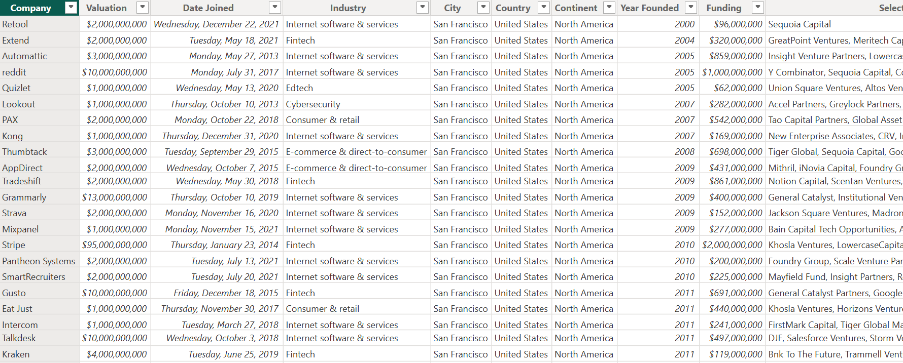
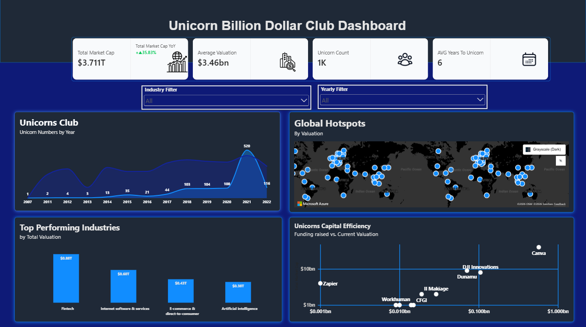

# The Billion-Dollar Club Report

## The Executive Summary
 This analysis evaluates the global landscape of "Unicorn" companies (startups valued over $1 billion). It identifies market trends, geographic hubs, and capital efficiency of each unicorn including individual valuations, funding raised, industry, geographic locations, and the time taken to achieve unicorn status.

 ## Business Context
The club’s executive requested a report to analyze the global landscape of "Unicorn" companies (startups valued over $1 billion). The report must empower Senior Investors to identify market trends, geographic hubs, and capital efficiency. Senior Partners & Venture Capitalists (VCs).

## Objectives
- This report addresses the following key questions:

- What is the total value of our potential market?

- How many opportunities (companies) are there currently?

- What is the average price tag of a deal?

- How fast do these companies typically scale?

## Data Overview
The dataset contains 1,074 rows and 10 columns which formed the basis of the   analysis. Covering the founded years of "Unicorn" companies worldwide (startups valued over $1 billion), including company valuations, funding raised, industry, geographic locations, and the time taken to achieve unicorn status.

## Data Preview

 ## Key Findings
- The global unicorn ecosystem has achieved a total market capitalization of approximately $3.71 trillion.
- The unicorn market recorded 35.83% year-over-year growth.
- Fintech emerges as the highest-performing industry by total valuation, outperforming Internet Software & Services, E-commerce, and Artificial Intelligence.
- Unicorn companies are concentrated in key global innovation hubs, particularly across North America, Europe, and Asia.

## Dashboard 

## Link to Power BI Report 
click the link to access the live Report : 

## [view dashboard](https://app.powerbi.com/view?r=eyJrIjoiOGI3YTI4ZTAtNzBhNC00YmQ5LWFlMmUtNjJmM2Y5MWRlOGY2IiwidCI6IjZjNzQ3Mzg1LTUyNTktNDcwMS05MTkzLTc5ZTkxNWNlYjA3ZSJ9)

## Data Cleaning and Transformation
-Removed duplicate entries from the entire dataset.
-Resolved formatting inconsistencies and addressed missing or duplicate records. 
-Converted fields into appropriate data types for accurate calculations and visualizations.
-Created measures and KPIs to support dashboard reporting and performance analysis.

## Detailed Findings & Analysis
 ### Key Performance Indicators 
-Total market capitalization of approximately $3.71 trillion
-The average unicorn valuation is $3.46 billion.
-The number of  unicorn companies is approximately 1,000.
-Unicorn companies take an average of 5.5 years to achieve billion-dollar status. 
-The unicorn ecosystem recorded a strong YoY growth rate of 35.83%, indicating a substantial increase in market activity compared to the previous year.

### Unicorn Growth Trends
-The number of unicorn companies increased steadily between 2007 and 2021, with 2021 recording the highest number of unicorns.
### Geographic Distribution
- Unicorn companies are primarily concentrated in North America, Europe, and Asia.
### Industry Performance
- Fintech is the leading sector by total valuation, demonstrating its strong market demand, innovation capacity, and attractiveness to investors.
### Capital Efficiency
- The funding-versus-valuation analysis reveals that several companies have achieved high valuations with comparatively lower levels of funding, indicating efficient use of capital and strong business scalability.

## Recommendations
 Investors should prioritize high-growth sectors such as Fintech, Internet Software & Services, and Artificial Intelligence, as these industries demonstrate strong valuation performance and continued market potential.
Encourage scalable business models and innovation-driven strategies, as unicorn companies achieve billion-dollar valuations within an average of 5.5 years.
Promote efficient capital allocation practices, as several companies attained substantial valuations relative to the funding they received.

## Tools Used
- Power Query: Data cleaning and transformation
- Power BI: Data analysis and visualization

##  Conclusion
The analysis demonstrates the scale and continued growth of the global unicorn ecosystem, with approximately 1,000 companies generating a combined market capitalization of $3.71 trillion. The findings highlight strong year-over-year growth, high average company valuations, the dominance of the Fintech sector, and the concentration of unicorn companies within major global innovation hubs, reflecting the critical role of innovation, access to capital, and scalable business models in achieving unicorn status.

